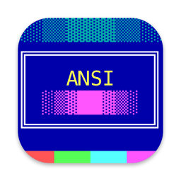

# AnsiView

View classic BBS ANSI art on your Mac. Select a `.ANS` file in Finder and press the
spacebar: AnsiView draws it the way a DOS screen did, with the VGA 16 color palette,
solid block and shade characters, and box drawing that lines up without gaps.

- **Quick Look preview.** Spacebar previews for `.ans`, `.ice`, `.diz`, `.nfo`, `.asc`, `.xb`, `.idf`, `.pcb` and `.avt` files.
- **Authentic fonts.** IBM VGA and EGA bitmap fonts chosen from the SAUCE font name, plus fonts embedded in XBin, ADF and IDF files, 9 pixel VGA mode, and 4:3 CRT aspect when the file asks for it.
- **Every common format.** ANSI, UTF-8 ANSI, 256 and 24 bit color (xterm and PabloDraw), BIN, XBin, ADF, IDF, PCBoard, Wildcat and Avatar. (`.bin` and `.adf` are not claimed in Finder because macOS already uses them for other file types; open them with File > Open.)
- **CRT effect.** View > CRT Effect adds scanlines, phosphor glow and screen curvature.
- **Animations play.** Files that redraw themselves replay at modem speed, from 300 baud
  to 115,200 baud or instantly. The default is 2400 baud, the speed most BBS animations
  were timed for. Click the art to skip to the end or replay.
- **Scrub and step.** Animations get a timeline bar under the art: drag it to any point, or
  step one frame at a time with the Left and Right arrow keys.
- **Speed per file.** The speed you pick is remembered for that file (and becomes the default
  for files you have not set).
- **Terminal scrolling.** Art taller than a 25 line screen scrolls like a terminal while it
  plays, following the cursor, then shows the whole piece when it finishes.
- **Hold Final Frame** (Playback menu) keeps the last frame of a playback on screen until you click.
- **Modem Sounds** (Playback menu, off by default) plays a synthesized dial, handshake and line
  noise while the art arrives. The sounds are generated by AnsiView; Quick Look stays silent.
- **BBS terminal.** Window > Dialing Directory (Command Option B) keeps your BBSes in a
  retro, keyboard driven phone book with call history, per BBS logins (passwords in the
  Keychain), automatic login scripts, redial, keyboard macros and session capture, and draws
  each BBS with the same fonts and renderer.
- **Blinking text blinks**, and iCE color files (SAUCE flag or `.ice`) get bright backgrounds instead.
- **Export** the current frame as PNG, JPEG or WebP, or the whole playback as an animated
  GIF, animated WebP or MP4 video, at 1x, 2x or 3x size, any playback speed and 5 to 30 frames
  a second. GIFs keep the art's exact colours (the 16 VGA colours for classic art) and store only
  what changed between frames. A size limit (1 to 10 MB, or fit 800 x 600 to 1920 x 1080) lowers
  the scale and frame rate until the file fits.
- **Export Text** (Option Shift Command E): HTML (coloured text in the bundled Px437 font),
  ANSI for modern terminals (24 bit or 256 colours, one line per row, no cursor movement),
  CP437 text or UTF-8 text.
- **Batch Export** (Option Command E) exports a gallery's selection, or a whole folder or art
  pack, in any of those formats, with a progress bar, Cancel and a list of any files that failed.
- **Share** the frame on screen or the playback (File > Share Image, Share Animation) through
  AirDrop, Mail, Messages and the rest of the share sheet.
- **SAUCE aware.** Honors the SAUCE width and iCE color flag and hides the metadata record.
  File > Get Info (Command I) shows the title, author, group, date, comments, font and flags.
- **Zoom.** Fit to Window, Integer Fit (whole pixels only, so every pixel is the same size),
  Actual Size, 2x and 3x, per window, in the View menu.
- **Presentation Mode** (View menu, Shift Command F) shows the art alone on a black screen with the
  menu bar, Dock and cursor hidden. Escape leaves.
- **Gallery and slideshow.** File > Open Folder or Art Pack (Shift Command O) shows a grid of
  thumbnails for a folder or a `.zip` art pack; the toggle at the right of its title bar switches
  between the grid and a list (small thumbnail, name and kind), and the choice is remembered for
  gallery windows. Slideshow > Start Slideshow (Option Command S) steps
  through a folder or pack with the Left and Right arrow keys, with optional Auto Advance.
- **Find in art** (Command F, then Command G / Shift Command G): a find bar over a viewer window
  outlines every match in the finished art and scrolls to each in turn (case and accents ignored).
  In a gallery Command F goes to its search field, which shows only the pieces whose words, name or
  SAUCE contain every word you type.
- **Compare.** File > Compare With..., or Compare with two pieces selected in a gallery, the
  library or the duplicate finder, shows two pieces side by side, scrolling together, with every
  cell that looks different tinted red, a count ("3 of 2,000 cells differ, on 2 rows") and
  Command G / Shift Command G to step through the rows that differ.
- **Auto scroll and minimap for tall art.** View > Auto Scroll (Shift Command A) moves tall art
  smoothly up the window at 2 to 48 lines a second (+ and - change speed, Space pauses, Escape or a
  click stops; the speed is remembered). Art at least twice as tall as the window gets a minimap
  strip at the right: the whole piece, with a box for the part on screen; click or drag to jump
  (View > Show Minimap turns it off).
- **Palettes.** View > Palette switches a window's colours at once, playback included: the art's
  own colours, VGA, CGA (dark yellow) or Greyscale, or a palette you load: JASC `.pal`, GIMP `.gpl`,
  Adobe `.act`, or the palette inside an XBin, ADF or IDF file. Next Palette is Option Command P.
  The choice is used for new windows too. Loaded palettes are copied into AnsiView's container.
- **Pack info.** When a gallery opens a pack or folder with a FILE_ID.DIZ or NFO files, a pane
  beside it shows them at once (a menu picks between several; View > Show or Hide Pack Info,
  Option Command I). Selecting a pack in the 16colo.rs browser previews its FILE_ID file.
- **Galleries stay fast on big folders.** Thumbnails for the pieces on screen are drawn first, and
  every thumbnail is kept in AnsiView's Caches folder (up to 300 MB), so a folder opens with its
  pictures at once the next time.
- **Library** (Window > Library, Shift Command L). Add folders of art (subfolders and the ZIP
  art packs in them are included; nothing is copied or moved). AnsiView indexes them in the
  background: each piece's words, SAUCE record and a thumbnail. Unchanged files are not read
  again on later scans. Then: search everything; rate pieces 0 to 5 stars (keys 0 to 5), mark
  favourites (F) and add your own tags (T); smart folders (saved searches by tag, rating,
  favourite, text, SAUCE title, author or group, format, year or date added, with Favourites,
  Rated 4 Stars or More, Untagged and Recently Added built in); and artist and group pages built
  from SAUCE, listing their pieces, years and the groups or artists they appear with, plus
  "Show on 16colo.rs", which lists the packs 16colo.rs has under that name (double click to open
  one). Tags and ratings follow a piece through renames and moves. The library is kept in
  AnsiView's container; folders are remembered with security scoped bookmarks. Measured on a
  generated 10,000 piece collection on an Apple M5: first index with thumbnails 11.8 s, a rescan
  with nothing changed 0.45 s, a search 4 to 9 ms.
- **Duplicates** (Window > Duplicates in Library, or Duplicates... in the library) finds exact
  copies (the same bytes) and the same art saved differently (cell for cell the same picture with
  another SAUCE record, other line endings or redundant codes) across the library's folders and
  packs. Nothing is ticked until you tick it or press Tick All but One (which keeps the copy with
  the shortest path); Move Ticked to Trash asks first and only ever moves files to the Trash.
  Pieces inside ZIP packs are listed but cannot be ticked.
- **Finder thumbnails.** Art files show the art itself as their Finder icon (except `.asc`, which
  macOS does not let thumbnail extensions claim).
- **Sample art.** File > Open Sample opens four original pieces bundled with the app: a static
  ANSI with a SAUCE record, an animation, a 24 bit colour picture and an XBin with its own font.
- **16colo.rs.** File > Browse 16colo.rs... lists the archive at [16colo.rs](https://16colo.rs) by
  year, pack and file, with a preview pane on the right. Selecting a file previews it at once:
  its 16colo.rs thumbnail when that is already saved, then the art itself drawn by AnsiView
  (animations play, blink blinks, tall art scrolls), with the SAUCE title, author and group under
  it. Files AnsiView does not draw (pictures, programs, music) show 16colo.rs's own picture of
  them. The arrow keys move through the files and the preview follows. Open (or Return, or a
  double click) opens the file in its own window, Open in Editor opens a copy in the editor, and
  Save to... saves the original file (the panel starts in Downloads). The files can be shown as a
  list or as a grid of 16colo.rs's thumbnails with names under them (the toggle at the bottom
  right; the choice is remembered), and each pack row shows a small picture of the pack (its
  FILE_ID.DIZ, as on 16colo.rs). Open Pack downloads the pack's ZIP and shows it in a gallery.
  Pictures load only for rows and grid items on screen, and stop loading when scrolled away.
  AnsiView sends one request at a time, at least a second apart, the file you selected before
  any thumbnail, and identifies itself as AnsiView. Thumbnails, previews, downloaded files and
  listings are kept in AnsiView's Caches folder, up to 200 MB (the least recently used go first;
  downloaded pack ZIPs are kept separately). Without a network the browser shows the listings,
  thumbnails and files it saved before and says it is offline. The art belongs to its artists.
- **Draw your own.** A TheDraw style editor (File > New ANSI Art, or File > Edit Art for a copy
  of the art in front): typing, F1 to F10 block character sets, half block drawing with the
  mouse, the 16 VGA colours with iCE, rectangle copy and paste, fill, undo, and saving as `.ans`,
  `.bin` or `.xb` with SAUCE. See [Drawing ANSI art](#drawing-ansi-art).
- **Images to ANSI.** File > Import Image..., File > Open on a picture, or dropping a picture on
  the Dock icon or an art window opens the import window: a live preview of the result next to
  the original, presets (Auto, Photo, Logo, Pixel art, Line art), perceptual colour matching,
  a best character per cell search, five dithering methods and picture adjustments. File >
  Convert Images to ANSI... and `ansirender --from-image` convert whole folders.
- **ANSI music.** Window > ANSI Music Editor composes BBS "ANSI music" (BASIC PLAY strings
  sent after `ESC[M`, `ESC[N` or `ESC[|`) with a piano roll and plays it like a PC speaker. Art
  files and BBSes that carry music play it as they draw (foreground music pauses the drawing,
  as the old terminals did), and MP4 exports keep it as a sound track. See [ANSI music](#ansi-music).
- **Open in an editor.** File > Open in Moebius and Open in PabloDraw hand the current file to
  [Moebius](https://github.com/blocktronics/moebius) or [PabloDraw](https://github.com/cwensley/pablodraw)
  when it is installed (AnsiView offers the download page when it is not).
- **VoiceOver** reads the art's text (block and line drawing characters are skipped) and announces
  its SAUCE title, author and group.
- **Updates.** AnsiView > Check for Updates... (the downloaded build; uses Sparkle).
- **Spotlight.** SAUCE fields and the words in the art are indexed, so Spotlight finds art by
  title, artist, group or text. (Install AnsiView in Applications; Spotlight looks for app
  importers there.)

## Install

1. Download the latest `AnsiView-x.y.z.dmg` from [Releases](../../releases).
2. Drag AnsiView onto Applications.
3. Open AnsiView once. This turns on the Quick Look preview.

Requires macOS 14 or later, on Apple silicon or Intel.

## Use

| Action | How |
| --- | --- |
| Preview | Select a file in Finder and press space |
| Open in the app | Double click the file |
| Skip or replay an animation | Click the art |
| Play / pause | Space (in the app) |
| Step one frame | Left / Right arrow |
| Scrub | Drag the bar under an animation |
| Faster / slower | Command ] and Command [ |
| Export image / animation | Command E / Shift Command E |
| Export text (HTML, ANSI, plain text) | Option Shift Command E |
| Batch export (gallery selection, folder or art pack) | Option Command E |
| Get Info (SAUCE) | Command I |
| Fit / Integer Fit / 1x / 2x / 3x | Command 0 / Option Command 0 / Command 1 / 2 / 3 |
| Presentation Mode (Escape leaves) | Shift Command F |
| Open folder or art pack | Shift Command O |
| Start slideshow | Option Command S |
| Next / previous art in a slideshow | Right / Left arrow, or Option Command Right / Left |
| Select cells to copy | Drag over the art (a click or Escape clears; Command A selects all) |
| Copy / Copy As Image / Copy As ANSI | Command C / Option Command C / Shift Option Command C |
| Find in art / next / previous | Command F / Command G / Shift Command G |
| Auto scroll (tall art) | Shift Command A; then + / - speed, Space pause, Escape stop |
| Next palette | Option Command P |
| Show or hide pack info (gallery) | Option Command I |
| Library | Shift Command L; in it 0 to 5 rate, F favourite, T tags, Return or Space open |
| Glossary (what is iCE, SAUCE, ZMODEM...) | Help > AnsiView Glossary (Command ?), or type a term in the Help menu's search field |

New to BBS art? **Help > AnsiView Glossary** explains every term AnsiView uses (iCE colours,
SAUCE, CP437, baud, art packs, PETSCII, ZMODEM, host keys: 78 terms in all) in plain English,
with related terms as links and where each one shows up in the app. The round (?) buttons beside
jargon controls open the same entries, every button and popup has a tooltip, and the Help menu's
search field lists glossary terms. The text lives in `Packages/AnsiCore/Sources/AnsiCore/Glossary.swift`.

The playback speeds you choose in the app (per file and default) are also used by the Quick Look preview.

### Drawing ANSI art

AnsiView has a simple TheDraw style editor (in the app only; Quick Look stays a viewer).

- **File > New ANSI Art** (Option Command N) starts an 80 x 25 canvas. **File > Edit Art**
  (Shift Command D) opens a copy of the art in the front window (the final frame of an
  animation); the original file is never changed. **File > Import Image...** (Shift Command I)
  converts a picture to block characters with a live preview and opens it in the editor (see below).
- **Typing.** Type at the cursor in the current colours; arrows move, Return goes to the next
  row, Backspace erases left, Delete erases the cell or the selection, Home / End go to the row's
  ends. Moving below the last row adds rows (up to 1,500). Characters outside code page 437 are
  skipped.
- **Block characters.** F1 to F10 type the ten characters of the current set (shown on the
  buttons above the canvas; click a button to type it). Option F1 to Option F10, or the Set popup,
  choose one of ten TheDraw style sets; set 6 (shades and half blocks) is the default. On keyboards
  where F keys control the Mac, hold fn.
- **Colours.** Click a swatch for the foreground; Option-click or right-click for the background.
  Without iCE colours the background is one of the eight dark colours (bright ones blink in
  classic ANSI); tick **iCE colours** for all sixteen. Turning iCE on or off converts the art
  the way its bytes would read (blinking cells become bright backgrounds and back).
- **Drawing.** In Draw mode the left button paints half block pixels in the foreground colour
  and the right button in the background colour; each stroke is one undo step. In Select mode
  (or with Shift and the arrows) drag a rectangle.
- **Selection.** Copy, Cut, Paste (see Copy and paste below), Art > Fill Selection with
  Character (the last block character used) and Art > Fill Selection with Colour (recolours,
  keeps the characters). With no selection the fills cover the whole canvas.
- **Pasting.** Paste shows the block floating at the cursor (or where you right-clicked).
  Move it with the arrows (Shift: 8 cells) or by dragging, place it with Return or a click,
  or press Escape to cancel. Tick **Transparent paste** (or press T while pasting) so spaces in
  the block leave the art underneath. Placing is one undo step. Plain text from other apps
  pastes in the current colours. A picture (a screenshot, an image copied from a browser)
  becomes block art with the last Import Image settings, as wide as the selection if there is
  one, otherwise as wide as the picture in pixels up to the canvas width.
- **Context menu.** Right-click in Select mode, or Control-click in any mode, for Cut, Copy,
  Copy As, Paste and Select All. In Draw mode the right button still paints.
- **Art menu.** Canvas Size... (1 to 1,000 columns, 1 to 1,500 rows), Edit SAUCE... (title,
  author, group), Toggle iCE Colours, Zoom In / Out (Command = / Command -).
- **Undo / Redo** in the Edit menu cover every change.
- **Saving.** File > Save asks for a name and a format the first time: ANSI (`.ans`),
  BinaryText (`.bin`, at most 510 columns; odd widths gain a blank column) or XBin (`.xb`).
  Every file gets a SAUCE record with the title, author, group, date, width (TInfo1), height
  and the iCE flag, and opens in AnsiView exactly as the editor shows it. ANSI files leave out
  trailing blank rows (as every ANSI viewer does), write colours outside the VGA palette as 24
  bit codes and replace the eight codes a terminal would obey (such as ESC) with look alike
  characters. BinaryText and XBin store the nearest VGA colour for colours outside the palette.

### Drawing tools (editor v2)

The editor has a tool palette on the left. Every tool and control has a tooltip, and the
status bar shows a hint for whatever is under the mouse (or the current tool). Every key below
can be changed in **Tools > Editor Shortcuts...**, which lists all actions, shows two actions
sharing a key in red, and resets to the defaults. Control keys work in every tool; plain letter
keys you assign yourself work outside the Text tool.

- **Tools.** Draw (half block pixels, Control D), Select (Control S), Line (Control L), Box
  (Control B), Fill (Control F), Text (Control T), Brush (Control R), Eyedropper (Control E).
  The bar under the colours shows the current tool's options.
- **Line.** Draw box lines that join by themselves: drag with the mouse, or use the arrows to
  draw behind the cursor (TheDraw line mode). Styles: single, double, single across with double
  down, double across with single down (Control K cycles them). Lines merge into boxes and
  lines already drawn, making the right corner, tee and cross characters, including the mixed
  single and double ones. Option-arrows (or the right button) erase segments and fix the
  characters next to them.
- **Box.** Drag a rectangle, a straight line or an ellipse. Styles: the four line styles
  (overlapping boxes join), solid, half blocks, light / medium / dark shade or the brush
  character. Rectangles can be filled (with spaces in the background colour, or the brush
  character), get a TheDraw style drop shadow, and a title in the top edge. Ellipses are drawn
  in half block pixels. A preview follows the mouse; nothing changes until you let go.
- **Brush.** Paints the brush character in the current colours, or (Colour only) recolours
  cells and keeps their characters; the right button uses the colours swapped. The Draw tool is
  the half block brush.
- **Character picker** (Control P, or the brush character button): all 256 CP437 characters.
  Hovering shows the code, its hex value, the Unicode character and its name; click to choose,
  Option-click or right-click to add or remove a favourite. Favourites and the 16 most recently
  used characters are kept.
- **Fill.** Click to flood fill the connected area (4-connected) that matches the clicked cell
  by character and colour, character only, or colour only, changing the character, the colours
  or both. **Tools > Replace...** changes a character and/or colours everywhere in the selection
  (or the whole canvas).
- **Colours.** Click a swatch for the foreground, Option-click or right-click for the
  background; the Aa box shows the current pair. Control X swaps them. The Eyedropper takes a cell's
  colours (Option-click also takes its character). Tools > Swap Colours in Selection swaps each
  cell's colours.
- **Insert and overwrite.** The Insert key (or Help on older Mac keyboards, or Tools > Insert
  Mode) switches; the status bar shows INS or OVR and the cursor becomes a bar. Insert mode
  shifts the rest of the row right as you type; Backspace and Delete close the gap. Control N /
  Control Y insert or delete a line, Control Shift N / Control Shift Y a column.
- **Moving a selection.** In the Select tool, drag from inside a selection to move it (the
  pointer is a hand there); Option-drag moves a copy and leaves the original. Option-arrows
  move a selection without the mouse (Shift-Option: 8 cells). While it floats, the arrows nudge
  it, Return or a click outside places it, Escape puts it back where it was, and T makes its
  spaces transparent. The place it came from is cleared to the background colour (transparent
  on an upper layer) unless **Leave a copy when moving** is ticked. The whole move is one undo
  step, and the block stays selected so it can be moved again. A pasted block is just cells once
  placed and moves the same way.
- **Mirror and rotate.** Control H mirrors the selection left to right, Control V top to
  bottom, Control U turns it 180 degrees and Control O a quarter clockwise (when the turned block
  fits the width). Box characters, half blocks, slashes, brackets and arrows are remapped so
  the picture turns too (┌ becomes ┐, ▀ becomes ▄). **Crop to Selection** keeps only the selection.
- **Layers.** The panel on the right adds, deletes, duplicates, reorders, hides, renames,
  merges down and flattens layers. On an upper layer an unset cell (a plain space in grey on
  black) is transparent. ANSI, BinaryText and XBin files always hold the visible layers
  flattened; **Tools > Save Project...** writes an `.ansiproj` file (JSON, documented in
  `docs/superpowers/plans/2026-10-30-ansiview-2.0-editor-tools.md`, ruling 11) that keeps them,
  and **Tools > Open Project...** opens one.
- **View.** Control ' shows a grid; Command = / Command - zoom (or pinch, or Control-scroll);
  scroll, hold Space and drag (outside the Text tool; a Space pressed and released without dragging still types), or drag with the middle button to pan.
  Tools > Full Screen Editing; Tools > Retro Theme switches to DOS style blue chrome.
- **What is kept.** Editing an opened file keeps its SAUCE title, author, group, comments
  (with their indentation), font name, flags, date and TInfo3/4. Anything that cannot be kept
  (an animation's earlier frames, an ANSiMation or other SAUCE file type, an XBin's embedded
  font or palette, data hidden after the end of file marker) is listed when the file opens, and
  saving tells you first about characters with no CP437 equivalent or colours a format cannot
  hold. (To edit an animation's frames, use Tools > Import Animation..., below.)

### Animation

A flipbook editor for ANSI animation, built into the editor (Tools > Animation Timeline, or
any project or import with more than one frame). Design and rulings:
`docs/superpowers/plans/2026-10-30-ansiview-2.0-animation.md`.

- **Frames.** **New Frame** (Control-Command-N) copies the current screen after it, so you only
  change what moves. Duplicate, Delete, and the arrows (Control-Command-[ and ]) step through
  frames. Each frame has its own layers and a **delay**: seconds it stays on screen once drawn.
  The strip under the canvas shows every frame: click to edit, drag to reorder, right-click to
  duplicate or delete. Frame commands are undoable.
- **Onion skin** draws the previous frame faintly over the one you are editing; cells that did
  not change look normal, cells that did show a ghost.
- **Record** keeps the timing of your drawing, so an As drawn export replays your pauses (each
  capped at 2 seconds).
- **Play** opens a preview that runs the exported file through AnsiView's own ANSI interpreter at
  the chosen speed (300 to 115200 baud), with the order, frame and elapsed time.
- **Export...** writes ANSI (`.ans`), GIF or MP4. After the first frame only the cells that
  changed are sent, with cursor positioning, in one of three orders: **As drawn** (the default,
  the order you made the changes), **Top down** (row by row) or **Full redraw** (clear and draw
  the whole frame). The sheet shows the file size of each order.
- **Delays without any special codes.** Plain ANSI has no "wait" command, so a delay is padding
  that costs time at the chosen baud rate: carriage returns (CR, 0x0D). A CR moves the cursor to
  column 1 and draws nothing, and further CRs do nothing, on ANSI.SYS, VT100 style terminals,
  SyncTERM and AnsiView. A 1 second delay at 2400 baud is 240 CRs (10 bits per character). The
  delay only shows where the file is played at that speed (a modem, a BBS that paces output, or a
  viewer that emulates baud rates, as AnsiView does); a viewer that draws instantly shows none. A
  terminal set to add a line feed after each CR (rare, off by default) would scroll.
- **Custom extension, off by default.** "AnsiView frame markers" add `ESC[?2416;<frame>;<ms>z`
  after each frame so AnsiView can import the frames and delays back exactly. It is not standard
  ANSI; the export sheet says whether a file uses it.
- **Import Animation...** opens an animated `.ans` as frames, split where the screen settles: a
  clear screen, a pause of 48 or more bytes that change nothing visible (0.2 s at 2400 baud), a
  frame marker, or drawing over a cell already changed in the frame being collected.
- **Project files** (`.ansiproj` version 2) keep every frame, delay and drawing order. A project
  with one frame is still written as version 1.

### BBS terminal

#### Dialing directory

Window > Dialing Directory (Command Option B; File > Connect to BBS... opens it too) is a phone
book of BBSes drawn as a DOS style text screen with AnsiView's own fonts. It lists each BBS's
name, address, last call and number of calls, with the selected BBS's notes and tags below. It
starts with one placeholder entry (`Example BBS (edit me)`, `bbs.example.com`) to edit or delete;
no BBS list is bundled. Everything works from the keyboard, and the buttons above the screen do
the same with the mouse (each has a tooltip):

| Key | Does |
| --- | --- |
| Up, Down, Page Up, Page Down, Home, End | move through the list |
| Enter (or double click) | dial the marked BBSes, or the selected one |
| Space / U | mark a BBS for the dial queue / clear the marks |
| N, E, C, D | new, edit, copy (duplicate), delete (asks first) |
| / | search names, addresses, notes and tags (Enter keeps the filter, Esc clears it) |
| S, T | cycle the sort (manual, name, address, last called, calls) / show one tag at a time |
| Option-Up, Option-Down, or drag a row | reorder (in manual order) |
| G, I, X | settings, import, export |
| Esc | clear a filter, or close |

The quick connect field calls an address without saving it (`bbs.example.com`,
`bbs.example.com:2323` or `telnet://bbs.example.com:2323`).

**Editing a BBS** (E or N) shows a text mode form: Up and Down move between fields, Enter goes
to the next, Left and Right (or Space) change a choice or a switch, typing edits text, and Esc
saves and goes back (Cancel discards). The line under the form explains the selected field. The
sections: Connection (name, host, port, protocol, tags, notes; then the chosen protocol's own
fields, see Connections below), Terminal
(terminal type, see below; the name sent when the BBS asks for the terminal type; columns and
rows; font; CP437 or UTF-8; iCE colours, which show blinking as bright backgrounds; simulated modem
speed; what Backspace sends; modem sound on, off or as Playback > Modem Sounds), Login (username,
password, show password, IEMSI login, log in automatically, busy text), the login script, Capture
(capture on connect and its folder) and the ten macros. Telnet entries also have Secure (TLS).
The bottom line shows when you last called and how many times.

**Terminal types.** Each BBS can use the terminal its software was written for:

| Type | For | Screen | Keys |
|---|---|---|---|
| ANSI-BBS (default) | PC boards: Synchronet, Mystic, WWIV, PCBoard, Renegade | 80x25, CP437 fonts | SyncTERM style, with DoorWay mode when the BBS asks |
| VT100, VT220 | Unix systems, Citadel | 80x24, DEC line drawing | application cursor keys when the host asks |
| Avatar (AVT/0+) | RemoteAccess, ProBoard, Maximus | 80x25 | as ANSI-BBS |
| RIPscrip | RIP boards (RIPscrip 1.54 menus) | 640x350 graphics under the text | click buttons and mouse fields |
| PETSCII (C64), PETSCII (C128 80 col) | Color 64, Image BBS, C*Base, Synchronet port 64/128 | 40x25 or 80x25, C64 or VDC colours | arrows, Home (HOME), End (CLR), Backspace (DEL), Insert, Escape (RUN/STOP), F1-F8, Control 1-8 colours, Control 9/0 reverse on/off |
| ATASCII (Atari) | BBS Express, Phorem XE | 40x24 | Return (EOL), Backspace, Delete, Insert, Tab, End (CLEAR) |
| Viewdata / Prestel | Telstar (raw TCP), NXtel | 40x24 teletext, 4:3 | Return and # send the Prestel # key; Terminal > Reveal Concealed Text |
| Mode 7 (BBC Micro) | BBC Micro boards | 40x25 teletext | BBC cursor codes |
| Apple II | GBBS Pro, ProLine, Warp Six | 80x24 (40 also works) | Apple arrows |
| Amiga ANSI | AmiExpress | 80x25, Topaz style font, ISO 8859-1 | as ANSI-BBS |

Choosing a type sets the screen size and the name sent first (unless you changed them). In a call,
Terminal > Terminal Type switches and redraws what the BBS sent so far. When the first bytes of a
call look like another type (a PETSCII clear screen, ATASCII line ends, RIPscrip lines, Viewdata
attributes, Avatar codes), a bar offers to switch; AnsiView never switches by itself. The fonts for
these types are AnsiView's own drawings (docs/FONTS.md). What works with which BBS family, and what
was checked against live boards, is in docs/BBS-COMPAT.md (Terminal).

**Telnet over TLS.** Turn on Secure (TLS) in a telnet entry (the port moves to 992). A certificate
macOS trusts connects at once; a self signed one shows its subject and SHA-256 fingerprint once and
is remembered; a changed certificate is refused with a warning (the entry's Saved certificate:
Forget clears it).

**IEMSI.** With IEMSI login on and a username and saved password, a BBS that asks for IEMSI
(`**EMSI_IRQ`, AmiExpress and some Maximus or Mystic boards) is answered with them. Off by default.

**Passwords** are saved only in your Mac's login Keychain (as internet passwords for the host,
port and username, labelled "AnsiView BBS: name"), never in AnsiView's preferences or in an
export. A password needs a username. Deleting a BBS deletes its Keychain item, unless another
entry uses the same host, port and username.

**Login scripts** are expect and send steps: when the BBS answers, AnsiView waits for each step's
prompt and then types the username, the password, some text, or Return. Matching ignores case,
spaces, control codes and ANSI colour codes, and `|` separates choices. The default script waits
for `login:`, `name:`, `nn:`, `handle:` or `user id:` and sends the username, then for
`password:` or `pw:` and sends the password, which covers the usual prompts of Synchronet, Mystic,
WWIV and ENiGMA 1/2 boards (inferred from their default prompts; not tried on live boards). A step
that waits longer than its timeout (30 seconds by default) stops the script, and the status line
says which prompt never came. Terminal > Log In (Command Option L) runs the script again;
Terminal > Send Username and Send Password type just one of them.

**Dialing.** Dial calls the queue in list order and shows the dialing panel: the BBS, its
address, the pass (attempt) and queue position, and the status (connecting, refused, busy, not
found, no answer). A BBS that answers comes up in its terminal window and its call is counted.
One that refuses, cannot be found or does not answer, or that shows its busy text (by default
`all nodes are busy`, and a few similar phrases) within 30 seconds of answering, is hung up; the
panel counts down the redial delay (10 seconds by default) and dials the next BBS, going round the
queue up to the number of passes (3 by default; both in Settings). Stop ends dialing, Dial Now
skips the wait, Skip moves to the next BBS. With modem sound on, the synthesized dial and
handshake play while connecting.

**Macros.** In a terminal, Option-1 to Option-0 type a macro. Each BBS has its own ten, and
empty ones fall back to the global macros in Settings (G). Write `\r` for Return, `\n` for line
feed, `\t` for Tab, `\e` for Escape, `\\` for a backslash and `\xHH` for any byte, for example
`/who\r`. While a terminal has the focus, Option-digit types macros rather than `¡™£¢∞§¶•ªº`.

**Capture on connect** saves everything a BBS sends to `<name> <date> <time>.ans` in the folder
you chose, from the moment it answers. AnsiView keeps permission to write there as an app scoped
security bookmark, which is why the app has the `files.bookmarks.app-scope` entitlement.

**Import and export.** Export (X) writes the directory to a JSON file without passwords or
capture folders. Import (I) reads such a file, a plan 7 style address book, or a SyncTERM
dialing directory (`syncterm.lst`): telnet, raw, SSH (and SSHNA, SSH without a password) and
RLogin entries come in (their passwords go into the Keychain), and RLoginReversed, TelnetS,
modem and other entries are listed as not imported. Entries already
in the directory (same name, host, port and username) are skipped.

**Settings** (G): redial passes and delay, showing the directory when AnsiView starts, and the
global macros. The directory is kept in AnsiView's own preferences; an address book saved by an
earlier build is moved into it the first time.

#### Terminal windows

Each connection opens a terminal window. Received text is drawn with the bitmap fonts and the
VGA palette, blinking text blinks, and the underline cursor blinks. The status line shows the
address, the connection state, speed, size, encoding and capture. Scroll up (mouse wheel, or
Shift Page Up / Shift Page Down) to read the last 2,000 lines that scrolled off; typing returns
to the live screen.

| Key | Sends |
| --- | --- |
| Return | CR (CR NUL in telnet text mode, as RFC 854 asks) |
| Backspace | BS (8), or DEL (127) when the entry says so |
| Arrows | `ESC[A` up, `ESC[B` down, `ESC[C` right, `ESC[D` left |
| Home, End, Page Up, Page Down | `ESC[1~`, `ESC[4~`, `ESC[5~`, `ESC[6~` |
| fn Delete (forward delete), Help (Insert) | `ESC[3~`, `ESC[2~` |
| F1 to F4 | `ESC O P` to `ESC O S` |
| F5 to F12 | `ESC[15~`, `17~`, `18~`, `19~`, `20~`, `21~`, `23~`, `24~` |
| Control-A to Control-Z | 1 to 26 |
| Letters, accented letters, box characters | the character in CP437 (or UTF-8) |

Paste (Command V) types the clipboard (line breaks become Return); Copy (Command C) copies the
screen as text. The Terminal menu has Disconnect, Reconnect (Command Option R), Send Username,
Send Password, Log In (Command Option L),
Speed (300 to 115,200 baud, or Unlimited: received text appears at that modem speed, typing is
never delayed), Size (80 x 25, 80 x 43, 80 x 50, 132 x 25, 132 x 50; the BBS is told the new
size), Capture Session... (saves everything received, as received, to an `.ans` file you can
replay in AnsiView), Stop Capture and Clear Scrollback. With Playback > Modem Sounds on, the
handshake plays while connecting.

Telnet: AnsiView offers TERMINAL-TYPE (it answers the BBS's terminal type, `ANSI` by default,
then the others of `ANSI`, `ANSI-BBS` and `VT100`) and
NAWS (the window size in characters, sent again on every Size change), asks the BBS to suppress
go ahead, lets the BBS echo, agrees to BINARY in either direction, and refuses every other
option. The terminal answers cursor position requests (`ESC[6n`), which many BBSes use to detect
ANSI, and device attribute requests, and supports scroll regions, insert and delete line and
character, save and restore cursor, and clear screen and line. Errors say what happened: an
address that could not be found, a refused port, no answer within 15 seconds, or the BBS
closing the connection. AnsiView only makes outgoing connections (the sandbox's
`network.client` entitlement, which the app already had for 16colo.rs); the Quick Look,
thumbnail and Spotlight extensions have no network access.

#### Connections: telnet, raw TCP, SSH, WebSocket, RLogin

The Protocol field of an entry picks how AnsiView reaches the BBS; the port follows the protocol
(23 telnet and raw, 22 SSH, 80 WebSocket or 443 with wss, 513 RLogin) unless you typed your own.

- **SSH** opens a session with a terminal (the entry's terminal type, columns and rows; a new
  size is sent when you change it) and logs in as the entry's username (`guest` when empty: most
  BBSes take any name and ask again on their own login screen). It first asks with no
  password at all (`none`: some BBSes let anyone in and ask on their own screen), then tries the
  key file if one is chosen, then the password saved in the Keychain (or an empty password when
  none is saved), then keyboard-interactive: a plain password prompt is answered once from the
  Keychain; any other question (a second prompt, a new password on first login, no saved
  password) opens a sheet with the server's prompts, and the answers are sent once and not saved.
  Key files: Ed25519 and ECDSA (P-256, P-384, P-521) in OpenSSH format, with or without a
  passphrase (kept in the Keychain; at most 1024 bcrypt rounds, OpenSSH's default is 16), and PEM
  ECDSA keys. RSA keys are not supported (the SSH
  library cannot sign with them); make an Ed25519 key with `ssh-keygen -t ed25519`. The first
  connection to a server shows its host key
  fingerprint (`SHA256:...`, as `ssh-keygen -l` prints it) and asks whether to trust it, unless
  the entry's Trust new host key is on; trusted keys are kept in
  `~/Library/Containers/com.traynham.AnsiView/Data/Library/Application Support/AnsiView/known_hosts`
  (OpenSSH format). If a server later offers a different key, AnsiView refuses to connect and
  shows both fingerprints; Forget the Saved Key (or the entry's Saved host key: Forget) lets the
  next connection ask again. **Algorithms:** modern ones are preferred (curve25519 and ECDH key
  exchange, Ed25519 and ECDSA host keys, AES-GCM), and the older ones classic BBS servers use
  follow: Diffie-Hellman group 16, group exchange and group 14 (and group 1 and SHA-1 variants
  last), RSA (rsa-sha2-512, rsa-sha2-256, ssh-rsa) and DSA host keys, AES-CTR, AES-CBC and 3DES
  with HMAC-SHA2, HMAC-SHA1 and HMAC-MD5. Synchronet and other cryptlib servers and ENiGMA 1/2
  connect. When a weak one is in use (SHA-1 or 1024 bit key exchange, ssh-rsa or ssh-dss, CBC or
  3DES, SHA-1 or MD5 MACs) the status bar says Legacy SSH encryption, and its tooltip names
  them. A server that offers nothing in common gets a message naming what failed and what it
  offers. The per board details are in [docs/BBS-COMPAT.md](docs/BBS-COMPAT.md).
- **WebSocket** connects to `ws://host:port/path`, or `wss://` with Secure on (TLS, with the
  Mac's certificate trust). Data goes out as binary frames; binary and text frames are shown.
  Subprotocols (such as `telnet` or `binary`) are sent when the BBS's web terminal names them.
  Telnet inside runs telnet negotiation through the WebSocket, for bridges that carry a raw telnet
  stream (fTelnet or websockify style). Errors name a TLS failure (for example a self signed
  certificate) or an HTTP answer instead of the upgrade, with its status code.
- **RLogin** (RFC 1282) sends the client user, server user (each your username unless set; Send
  password puts your Keychain password in the client user, as Synchronet style servers expect) and
  terminal type with the speed (`ansi/38400`, or the simulated speed), and shows the server's
  refusal text if it refuses. The window size is not sent: the server asks for it with TCP urgent
  data, which macOS's Network framework does not expose. The sandbox cannot use a privileged
  source port, which BBS RLogin servers do not require.

SSH and RLogin already send the username, so the login script does not run by itself on them
(Terminal > Log In still runs it). For file transfers, every transport carries all 256 byte
values unchanged (telnet doubles 255 and needs BINARY both ways for CR; SSH, WebSocket binary
frames and RLogin after its handshake are clean).

#### File transfers

The terminal sends and receives files with XMODEM, XMODEM-CRC, XMODEM-1K, YMODEM, YMODEM-G,
ZMODEM and Kermit over every connection type (telnet, raw TCP, SSH, WebSocket, RLogin).

- **Which protocol?** ZMODEM if the BBS offers it: it is the fastest, sends names and sizes,
  starts by itself and resumes an interrupted download. Otherwise YMODEM (several files with
  names), then XMODEM-1K. Kermit is slower but works on lines that are not 8 bit clean. YMODEM-G
  is very fast but stops at the first line error. The (?) buttons explain each one.
- **Download:** start the download on the BBS, then Terminal > Download... (Option-Command-D),
  pick the protocol (XMODEM also asks for a file name, since it sends none). ZMODEM and Kermit
  downloads need no menu: when the BBS starts one, a bar at the bottom of the terminal asks
  "The BBS wants to send files with ZMODEM: Receive / Ignore". It asks because ordinary text can
  look like a transfer start; Ignore shows what arrived as text and does not ask again for a
  minute (type Ctrl-X five times to stop the BBS's sender at once). The dialing directory entry's
  "Auto-accept ZMODEM" setting skips the question for ZMODEM downloads.
- **Upload:** start the upload on the BBS, then Terminal > Upload File(s)... (Option-Command-U),
  choose files and the protocol. When the BBS starts a ZMODEM or Kermit receive by itself, the
  bar offers "Choose Files to Upload". XMODEM sends one file at a time.
- **While a transfer runs** the terminal shows a panel: file name, file N of M, bytes, total,
  a progress bar, speed, time left, protocol, block size, errors and retries, and where a
  resumed download continued. The screen is paused (the BBS's bytes go only to the protocol),
  ANSI music stops, and keys do nothing except Escape, which cancels like the Cancel button and
  Terminal > Cancel Transfer. On cancel AnsiView sends the cancel sequence so the BBS stops too.
- **At the end** the panel lists every file with its size and SHA-256, where it was saved
  (Reveal in Finder), and the protocol log. Terminal > Transfer Log shows every transfer with
  that BBS; the logs are kept in AnsiView's container
  (`~/Library/Containers/com.traynham.AnsiView/Data/Library/Application Support/AnsiView/Transfer Logs`).
- **Where files go:** each dialing directory entry can have its own download folder (File
  transfers section of the entry editor, or Change... in the Download dialog); otherwise the
  first download asks for a default folder (the panel opens in Downloads) and AnsiView keeps
  its permission (a security scoped bookmark: the app is sandboxed and can write only where you
  chose). Names from the BBS are cleaned (no paths, no device names), existing files are never
  overwritten (`name-1.ext`), and a file arrives as `name.part` until it is complete.
- **Partial files and resume:** a cancelled or failed ZMODEM download keeps its `.part`, and the
  next ZMODEM download of the same file continues from there. Other protocols cannot resume, so
  their partial file is removed.
- **Telnet:** before a transfer AnsiView asks the BBS for telnet binary mode both ways. If the
  BBS refuses, the panel warns; ZMODEM then also escapes the bytes telnet could change and
  Kermit uses 8th bit prefixing, but XMODEM and YMODEM may fail on such a line.
- The entry editor remembers the protocol you used last for each BBS.

### Copy and paste

Drag over the art in any AnsiView window (the viewer, slideshows and presentation mode, not
Quick Look) or select in the editor, then Edit > Copy (Command C). One copy offers:

- the cells themselves, so pasting into the AnsiView editor gives exactly the same characters
  and colours;
- plain Unicode text (code page 437 mapped), for TextEdit, Notes or a code editor;
- ANSI text with 24 bit colour codes, for terminals (`pbpaste > art.ans`, then `cat art.ans`);
- a PNG and TIFF picture of the selected cells in the art's font, for Preview, Messages, Pages
  or Mail.

Each app takes the kind it understands. **Edit > Copy As** puts just one kind on the clipboard:
Text, ANSI (escape codes, for terminals) or Image. In an animation the copy is of the frame on
screen. Very large selections (beyond about 160 MB of pixels) are copied without the picture.

**Copy As > Discord** writes a ` ```ansi ` code block in the 8 colours Discord shows (bright
colours become bold, black backgrounds stay Discord's own); paste it into a Discord message.
Discord's phone apps show it without colour, and a message holds 2,000 characters (AnsiView says
so when the copy is longer). **Copy As > Slack** writes a plain ` ``` ` block of the characters:
Slack code blocks have no colour. The colour table is in `docs/CHAT-COLOURS.md`.

### Output and system integration

- **File > Export Wallpaper...** saves a PNG the exact pixel size of a display (for example
  3024 x 1964 on a 14 inch MacBook Pro), the art centred at the largest whole scale that fits or
  tiled, and can set it as that display's desktop picture.
- **File > Export Animation** with MP4 has **Include modem sound**: the synthesized dial tone and
  handshake over an empty screen, then line noise while the art arrives, then quiet, timed as
  Playback > Modem Sounds plays them. The sounds are generated by AnsiView, not recordings.
- **Screen saver:** File > Install Screen Saver... hands `AnsiView.saver` to macOS, which asks
  before adding it. Options (System Settings > Screen Saver > Options): a folder of art, speed and
  how long each piece stays. macOS runs screen savers in a sandbox, so if the folder cannot be
  read the bundled samples play.
- **Shortcuts:** "Render ANSI Art to Image" (PNG, JPEG or animated GIF) and "Convert ANSI Art to
  Text" (UTF-8, CP437, ANSI, HTML) appear under AnsiView in the Shortcuts app and run without
  opening a window.
- **AppleScript:** `tell application "AnsiView" to render file "Mac:art.ans" to file "Mac:art.png" scale 2`
  and `convert file "Mac:art.ans" in format "utf8"` (returns the text; add `to file ...` to write
  it). The dictionary is in File > Open Dictionary in Script Editor.
- **Finder Quick Actions:** select art in Finder, then Quick Actions (or the Services menu) >
  Convert to PNG or Convert to GIF. AnsiView does not open. The sandbox lets these actions read
  the file Finder hands them but not write beside it, so the result usually lands in Downloads
  (beside the art when the folder allows it); existing files are never replaced. If they are not
  listed, turn them on in System Settings > General > Login Items & Extensions (the Extensions
  list).
- **Art of the day:** View > Show Art of the Day in Menu Bar (off by default) puts a picture in
  the menu bar showing one piece from your Library each day (favourites and 4 or 5 star pieces
  first; the samples when the Library is empty). "Also show a piece from 16colo.rs" (off by
  default) adds one from 16colo.rs: at most four requests a day, a second apart, cached.
- **Localization:** the app, Quick Look preview, screen saver and Quick Actions have String
  Catalogs (`*.xcstrings`), English only so far. After building, `Packaging/sync-strings.sh`
  adds new strings the compiler found. Text written with SwiftUI or `String(localized:)` is in
  the catalogs; many AppKit labels are still plain strings and need converting before a
  translation is complete. Xcode's pseudolanguages (scheme options, or the
  `-NSAccentuateLocalizedStrings YES` and `-NSDoubleLocalizedStrings YES` launch arguments)
  show which text goes through the catalogs.

### Importing images

Open a picture any of these ways: File > Import Image... (Shift Command I), File > Open, drag it
onto the Dock icon or onto an art window, or Open With > AnsiView in Finder (AnsiView is only an
alternate app for images, never the default). Anything macOS reads works: PNG, JPEG, HEIC, TIFF,
WebP, GIF (its first frame). Transparent areas become black.

The import window shows the original and the result in one frame, updated after every change
(on this Mac about 150 ms for an 80 column result, including a short wait while you drag a
slider). Split puts a divider you drag between original and result; Side by side, Original and
Result show them separately. Zoom (buttons, pinch, Command scroll) and pan (drag, scroll) move
both images together. Crop lets you drag a rectangle on the picture to convert only that part.
The status line gives the result's size in characters and bytes and how different it looks
from the picture (lower is better, about 1 is barely visible). Every control has a tooltip, and
the (?) buttons explain iCE colours, dithering, OKLab, the XBin palette, aspect correction and
the score. Open in Editor opens the result for touching up; Save As... writes the file directly.
The settings are remembered.

- **Presets.** **Auto** (the default) converts with seven methods, scores each against the
  picture and shows the best three as thumbnails to pick from. **Photo**: best character per
  cell with light serpentine dithering. **Logo / flat art**: best character, no dithering.
  **Pixel art**: one picture pixel per half block (the width becomes the picture's width), no
  smoothing, no dithering. **Line art**: best character including line and box characters, auto
  levels and extra contrast (it picks characters; it does not trace edges into connected box
  drawing). Changing a method setting by hand switches to Custom.
- **Characters.** *Best character per cell* tries the space, full block, the four half blocks
  and the three shades (optionally also `■ ─ │ ┼ / \ _ ═ ║ ∙`) with every colour pair against
  that part of the picture at the font's 8x16 resolution and keeps the closest. Also: half
  blocks (two pixels per cell), full blocks, shades.
- **Colours.** The 16 VGA colours (`.ans`); 16 colours fitted to the picture (median cut and
  k-means in OKLab), saved as XBin (`.xb`, which carries its own palette); or 24 bit truecolor
  (`.ans`). Colours are matched by how different they look (OKLab), not by raw RGB numbers, with
  hue counting double so grey stays grey; light is mixed in linear RGB.
- **Dithering.** None, Floyd-Steinberg, serpentine Floyd-Steinberg, Atkinson, Sierra Lite or
  ordered (Bayer 4x4), with a strength from 0 to 100%.
- **Picture.** Auto levels, brightness, contrast, saturation, gamma, sharpen, and Remove
  background (flood fills the edge colour from the borders with a tolerance, for logos).

File > Convert Images to ANSI... converts many pictures or folders of pictures with the current
import settings into a folder you choose (names never overwrite existing files). The same
conversion is on the command line:

```sh
ansirender --from-image photo.jpg --width 80 -o photo.ans
ansirender --from-image photo.jpg --preset auto -o photo.ans   # prints the method Auto chose
ansirender --from-image logo.png --palette xbin -o logo.xb     # 16 colours fitted to the picture
ansirender --from-image sprite.png --preset pixel -o sprite.ans
ansirender --from-image pictures/ more.png -o converted/       # folders and many files need -o <folder>
cat photo.png | ansirender --from-image - > photo.ans          # - reads standard input
# --preset auto|photo|logo|pixel|line  --mode glyph|half|full|shade  --palette vga|truecolor|xbin
# --dither none|fs|serpentine|atkinson|sierra|ordered  --strength 0-100  --extended-glyphs
# --ice|--no-ice  --no-aspect  --nearest  --levels  --brightness/--contrast/--saturation -100-100
# --gamma 0.2-5  --sharpen 0-200  --remove-background [0-50]  --crop x,y,w,h
```

### Text art fonts (TheDraw and FIGlet)

Tools > Text to ASCII... (also in the Window menu) shows what you type in every installed font at
once: TheDraw fonts (.tdf: outline, block and colour) and FIGlet fonts (.flf). Cards draw in the
background, visible ones first, so typing never waits (246 fonts: about 6 ms to the first card and
under 0.1 s for all, measured offscreen). Search, pick a kind, sort by name, height or width, star
favourites (they come first, then recently used). Select a card for the detail pane: FIGlet
horizontal and vertical layout (font default, full width, fitted, smushed, universal smush), wrap
at a width, alignment, colours or a gradient for fonts without their own colours, TheDraw outline
style (all 19) and letter spacing. Copy as text (Unicode or ASCII only), ANSI, a picture, a code
comment (`//`, `#`, `--`, `/* */`, `;` or a box) or Markdown; save as .txt, .ans or .png; drag a card
out as text. Arrows move between cards, Return copies, Command-F searches.

In the editor, Tools > Text Art... opens the same window with Insert into Editor: the art floats at
the cursor like a paste (move it, click or Return to place it, one undo step; Escape cancels;
Transparent leaves the art underneath the spaces). Colour fonts keep their own colours; on an iCE
canvas their blink bit becomes a bright background.

Tools > Font Manager... lists the installed fonts (a .tdf with several fonts lists each one) with a
preview of your sample text, and imports files, folders and .zip packs into AnsiView's own font
folder, removes and reveals them. AnsiView comes with four original fonts (AV Outline, AV Block,
AV Ember, AV Contour) and the 18 fonts of the FIGlet 2.2.5 distribution (New BSD); import your own
collections for the rest. Formats, rulings and sources: [docs/FONTS.md](docs/FONTS.md).

Tools > TDF Font Editor... creates a TheDraw font (outline, block or colour) or opens a .tdf file,
and Font Manager's Edit Font... opens the selected one. The window lists the fonts in the file (add,
duplicate, rename, delete, reorder), shows the 94 characters as a grid (copy, paste, clear, or copy
a glyph from another installed font), and draws the selected glyph on the editor's own canvas with
all its tools, at the glyph's size (up to 30 by 12, TheDraw's limit). Outline fonts get buttons for
the outline codes and a strip with the glyph in all 19 outline styles. The preview draws your text
with the font as you edit, with the renderer Text to ASCII uses. Save writes the .tdf (fonts saved
into AnsiView's font folder update Font Manager and Text to ASCII at once; Install in Font Manager
copies other files there). Rulings: docs/superpowers/plans/2026-10-30-ansiview-2.0-tdf-editor.md.

### ANSI music

BBS terminals such as Qmodem, Telix and TeleMate played music sent as an escape sequence: `ESC [ M`,
a BASIC `PLAY` string, then Ctrl-N (0x0E). BananaCom added `ESC [ N` and SyncTERM `ESC [ |`
because `ESC [ M` is also Delete Line. AnsiView follows the GW-BASIC `PLAY` language (notes A to G
with `#`, `+`, `-`, lengths and dots; `O`, `<`, `>`, `L`, `N`, `P`, `T`; `MN`, `ML`, `MS`; `MF`, `MB`)
and SyncTERM's handling of the escape sequences (its four modes, `ESC[=Ps M`, the rule that
`ESC[MF` means foreground). Octave 4 C is 1046.5 Hz and a quarter note lasts 60/T seconds,
as in GW-BASIC. The sources and every compatibility decision are in
`docs/superpowers/plans/2026-10-30-ansiview-2.0-music-core.md`.

Window > ANSI Music Editor (Shift-Command-M):

- A piano roll over the 7 octaves of `PLAY`: click to add a note, click a note to select it or move
  it, drag its right edge to change its length, Delete to remove it. Keys A W S E D F T G Y H U J K
  play C to C, Z and X change octave, 1 to 7 pick the length, period adds a dot, Space a rest.
- The `PLAY` string beside it, in sync both ways; tempo, articulation, MF/MB and sound controls;
  play, pause and stop with a playhead. Every control has a tooltip and (?) buttons explain the jargon.
- A library of named snippets (kept in AnsiView's container, Application Support), demo tunes
  (public domain melodies and original pieces), import from an `.ans` file, and export: copy the
  escape sequence, save it as an `.ans` snippet, embed it into a copy of an `.ans` file (at the
  start, the end of the art, or after a line; SAUCE is kept), WAV, and MIDI as an extra.

On the command line:

```sh
ansirender --music art.ans                    # sequences with byte offsets and durations
ansirender --music-wav art.ans music.wav      # --soft for a gentler tone, --mode off|pipe|bananacom|all
ansirender --music-midi art.ans music.mid
ansirender --music-wav --play "T120 O3 L8 C D E F G4" tune.wav
ansirender --animate mp4 2400 2 art.ans art.mp4 --with-music   # MP4 with the music as its sound track
```

#### Playback in viewer windows, the terminal and exports

- **Viewer.** A tune plays when the playback cursor passes it, at any speed. Foreground music
  (`MF`, the default) pauses the drawing until it ends; background music (`MB`) plays while the art
  keeps drawing. Tunes share one speaker, so each starts when the one before has finished. Art whose
  only movement is music replays at modem speed like an animation, with a scrub bar. At Instant
  speed the art appears at once and its music plays once from the start. Pause pauses the music;
  seeking, Replay, Skip to End and closing the window stop it; a tune still sounding when the art
  finishes on its own plays out. A small "♪ ANSI music" badge shows while music plays (click it
  to mute the window).
- **Playback menu.** Play ANSI Music (on by default, shared with every window), Play Music at
  Instant Speed (on by default), Mute Music in This Window (not remembered), About ANSI Music...
- **Quick Look** never plays sound: its preview has no music output, so music neither sounds nor
  pauses the drawing there, and art whose only movement is music stays a still picture.
- **Terminal.** Each dialing directory entry has an "ANSI music" choice: Off, `ESC[|` only, BANSI
  (`ESC[|` and `ESC[N`, SyncTERM's default and AnsiView's), or All (also `ESC[M`, which then is no
  longer Delete Line). A BBS can switch with `ESC[=0M`, `ESC[=1M` or `ESC[=2M` unless the entry says
  Off. Music plays when its bytes reach the screen at the simulated speed; foreground music holds
  the rest of the screen until it ends. Captures keep the music bytes.
- **Export.** File > Export Animation adds an "Include ANSI music" checkbox for art with music
  (on by default): MP4 gets an AAC sound track timed with the frames, and the frames hold during
  foreground music as in the viewer. GIF and WebP have no sound; the panel says so.

The timing rules and the reasons behind them are in
`docs/superpowers/plans/2026-10-30-ansiview-2.0-music-playback.md`.

### BBS screens (Screen menu)

For SysOps designing a board's menus and screens. AnsiView is the caller side, not a BBS host:
screens are exported into your BBS install folder, or uploaded through the terminal.

- **File > New from Template...** (or Screen > New from Template...): ten original templates
  (matrix / login, welcome, main menu, goodbye, bulletin list, message area header, file area
  header and list, door games menu, ANSI ad, and an animated loading screen), drawn for your BBS
  name, your package's display codes and 80 or 132 columns. Everything is editable art.
- **Screen > Insert Display Code...**: a searchable list of your package's codes (user name, time
  left, node, clear screen, colours...) with what each shows. Insert types the exact characters
  the BBS reads at the cursor. **Sample Values...** sets what the previews show for each code;
  **Sample Values Preview** shows the frontmost screen with the codes replaced, live.
- **Screen > Component Library...**: headers, frames in the box tool's styles, hotkey legends,
  status lines with your package's codes, separators and logos in any installed font. Insert floats
  it in the editor like a paste. **Save Selection as Component...** keeps your own.
- **Screen > Preview as Caller...**: the screen as the BBS sends it, through AnsiView's terminal
  emulator at 300 to 115200 baud, 80 x 24, 80 x 25 or 132 x 37, CP437 or UTF-8, iCE on or off.
  Warnings: lines wider than the terminal, lines that fill column 80 (an extra blank line on
  terminals that wrap at once), the bottom right cell (the screen scrolls), screens taller than the
  terminal, codes of another package, colours the package cannot send; with file size and time.
- **Screen > Export Profiles...**: one per BBS install: package, install folder (AnsiView keeps
  permission to write there), theme folder, CP437 or UTF-8, ANSI colours or the package's own codes,
  line ends, SAUCE. It lists the file each screen becomes; names a package does not document are
  marked "suggested".
- **Screen > Export to BBS...** writes the file into the folder with the right name. An existing
  file is replaced only after you confirm. The first file replaced is kept as `<name>.bak` and never
  overwritten (it is usually your original); later replacements keep the previous version as `<name>.bak2`.
  **Screen > Screen Set...** lists what was exported per profile with its status (exported,
  modified since, changed in the BBS folder, missing) and Export Again, Upload via Terminal and
  Reveal in Finder. **Upload via Terminal...** connects with a dialing directory entry and, once you
  have started the upload on the BBS, sends the file with that entry's protocol.
- **Screen > Open with BBS Codes...** opens a file written with a package's colour codes (pipe
  codes, Ctrl-A, @X...) as editable art.

20 packages are supported, each from its own documentation: Synchronet, Mystic, WWIV, ENiGMA1/2,
PCBoard, Wildcat!, Renegade, Telegard, Iniquity, Oblivion/2, Impulse, Celerity, RemoteAccess,
ProBoard, QuickBBS, Spitfire, Searchlight, DayDream, Talisman and Maximus (MECCA). What each one
covers, its sources, and what is still missing for others are in `docs/BBS-COMPAT.md`; the design
and rulings are in `docs/superpowers/plans/2026-10-30-ansiview-2.0-screen-designer.md`.

### iPhone and iPad

AnsiView for iPhone and iPad (iOS and iPadOS 17 or later, target `AnsiViewiOS`) is a viewer built
on the same AnsiCore renderer as the Mac app:

- Opens .ans .asc .ice .nfo .diz .txt .bin .xb .adf .idf .pcb .avt: the bundled samples, files in
  the app's own folder (the Files app shows it as On My iPhone or On My iPad > AnsiView), files
  picked with Open from Files, and files sent to AnsiView from other apps (read in place, with
  security scoped access while reading).
- The real VGA and other bundled bitmap fonts, iCE colours, blink, 24 bit colour, XBin fonts and
  palettes. Pinch to zoom (up to 8 points per font pixel), drag to scroll, double tap for fit or
  2x. Animated art replays at modem speed when opened (speed menu: 300 baud to 115200 and
  Instant); tap to skip, or to replay a finished animation. Tall art plays in a 25 line window.
- Info shows the SAUCE record. Share sends a PNG or an animated GIF to the share sheet.
- A Quick Look preview extension (the Files app and any app that previews files) plays the art
  at 2400 baud, and a thumbnail extension draws Files thumbnails for ANSI art. Neither extension
  has any entitlements.
- Universal layout, dark mode, Dynamic Type for the lists and sheets, VoiceOver reads the art's
  title and its text.

Not on iPhone and iPad (Mac only): the BBS terminal, the editor, file transfers, SSH, ANSI music,
modem sounds and 16colo.rs browsing.

Build for the simulator: `xcodegen generate`, then
`xcodebuild -project AnsiView.xcodeproj -scheme AnsiViewiOS -destination 'generic/platform=iOS Simulator' build`.
Running on a device, TestFlight and the App Store need the owner's Apple developer account
(automatic signing with team 47HEHK53W5; bundle ids `com.traynham.AnsiView.iOS`, `.iOS.Preview`,
`.iOS.Thumbnail` registered on first device build).

## Build from source

Needs Xcode 16 or later and [XcodeGen](https://github.com/yonaskolb/XcodeGen).

```sh
./install.sh   # build, install to ~/Applications, register Quick Look
./release.sh   # signed, notarized DMG in dist/ (needs a Developer ID certificate)
```

`ansirender` is a command line build of the same renderer:

```sh
ansirender art.ans art.png
ansirender --animate gif 2400 1 art.ans art.gif
ansirender --stats *.ans

# Any format with export controls
ansirender --export gif --scale 1 --fps 10 --palette vga --max-bytes 500000 art.ans art.gif
# Batch: files, folders or .zip art packs into a folder (existing files are kept unless --overwrite)
ansirender --batch png --scale 2 out/ ~/art/ pack.zip
# Text conversions (to stdout without an output path)
ansirender --convert ansi art.ans          # 24 bit colour for modern terminals (ansi256 for 256 colours)
ansirender --convert text art.ans art.txt  # CP437 text, no escapes (utf8 for UTF-8 text)
ansirender --convert html art.ans art.html # --inline for style attributes, --no-font for no embedded font
# Images to block character ANSI (see Importing images)
ansirender --from-image photo.png --width 80 -o photo.ans
# Text art fonts (ANSI to stdout without -o; .png and .txt by extension)
ansirender --font pack.tdf --font-index 2 --outline-style 5 --fg 11 --text "HELLO" -o hello.ans
ansirender --font standard.flf --layout fit --width 60 --align center --text "Hi there" -o hi.txt
ansirender --list-fonts pack.tdf *.flf
ansirender --figlet-gallery "HELLO"        # every bundled font (--font-dir <folder> adds yours)
ansirender --export-original-fonts out/    # AnsiView's original fonts as .tdf and .flf
# Pictures in modern terminals: sixel (xterm -ti vt340, mlterm, WezTerm, foot, iTerm2) or kitty graphics
ansirender --sixel art.ans
ansirender --kitty --scale 2 art.ans
# Desktop picture of an exact size, centred or tiled
ansirender --wallpaper 2560x1440 centred art.ans wallpaper.png
# MP4 with the synthesized modem sound (and the art's ANSI music)
ansirender --export mp4 --baud 9600 --with-modem --with-music art.ans art.mp4
```

ANSI conversions carry no width record, so art wider than 80 columns reopens in AnsiView at 80.
`ansirender --version` prints the version and build number.

### Sample art

`swift Packaging/samples/generate.swift Samples` regenerates the bundled samples (the same bytes
every time; a test checks the committed files match).

### Updates (Sparkle)

The direct download build checks `docs/appcast.xml` on `main`
(`https://raw.githubusercontent.com/btray77/AnsiView/main/docs/appcast.xml`) with
[Sparkle](https://sparkle-project.org) 2. Until a real public key is set, updates are off: the app
logs "Updates disabled: SUPublicEDKey is a placeholder" and Check for Updates... says so.

One time setup (owner; keeps the private key in the login keychain):

```sh
./install.sh                                         # fetches Sparkle's tools via Swift Package Manager
build/SourcePackages/artifacts/sparkle/Sparkle/bin/generate_keys      # prints the public key
build/SourcePackages/artifacts/sparkle/Sparkle/bin/generate_keys -x ~/sparkle-private-key.txt  # back it up somewhere safe
```

Put the printed public key in `SUPublicEDKey` in `project.yml` (replacing
`REPLACE_WITH_SPARKLE_PUBLIC_ED_KEY`). For each release:

```sh
./release.sh                                         # notarized dist/AnsiView-x.y.z.dmg
Packaging/sparkle/update-appcast.sh dist/AnsiView-x.y.z.dmg
# attach the DMG to the GitHub release vx.y.z, then commit and push docs/appcast.xml
```

`update-appcast.sh` runs Sparkle's `generate_appcast` (signature, length, minimum macOS) and points
the download at `https://github.com/btray77/AnsiView/releases/download/vx.y.z/AnsiView-x.y.z.dmg`.
Sparkle compares `CFBundleVersion` (the build number), so every release needs a higher one.

### Mac App Store variant

The Sparkle code is compiled only with the `SPARKLE_UPDATES` Swift condition. A build without
Sparkle (no framework, no updater menu item, no Sparkle entitlements):

```sh
xcodegen generate --spec Packaging/appstore/project-appstore.yml
xcodebuild -project Packaging/appstore/AnsiViewAppStore.xcodeproj -scheme AnsiView -configuration Release build
```

Store signing (Apple Distribution certificate and provisioning profile) is not set up.

### Homebrew

`Packaging/homebrew/ansirender.rb` builds `ansirender` from a tagged source release (it needs Xcode,
not just the Command Line Tools). Once the tap exists:

```sh
brew install btray77/ansiview/ansirender
```

To try the formula from a checkout before a release, use a throwaway local tap and a tarball of the
working tree (`HOMEBREW_NO_AUTOREMOVE=1` stops `brew uninstall` from also removing unrelated unused
formulae):

```sh
export HOMEBREW_NO_AUTO_UPDATE=1 HOMEBREW_NO_AUTOREMOVE=1
git archive --prefix=AnsiView-2.0.0/ -o /tmp/AnsiView-2.0.0.tar.gz HEAD
brew tap-new ansiview/localtest --no-git
TAP=$(brew --repository)/Library/Taps/ansiview/homebrew-localtest
sed -e "s#https://github.com/btray77/AnsiView/archive/refs/tags/v2.0.0.tar.gz#file:///tmp/AnsiView-2.0.0.tar.gz#" \
    -e "s#0\{64\}#$(shasum -a 256 /tmp/AnsiView-2.0.0.tar.gz | cut -d' ' -f1)#" \
    Packaging/homebrew/ansirender.rb > "$TAP/Formula/ansirender.rb"
brew install --build-from-source ansiview/localtest/ansirender
brew test ansiview/localtest/ansirender
brew audit --strict ansiview/localtest/ansirender
brew uninstall ansirender && brew untap ansiview/localtest
```

Publishing it (owner): create the public repository `btray77/homebrew-ansiview`, tag the release
`v2.0.0` and push the tag, set the formula's `sha256` to
`curl -sL https://github.com/btray77/AnsiView/archive/refs/tags/v2.0.0.tar.gz | shasum -a 256`,
and commit the formula as `Formula/ansirender.rb` in the tap. Bump `url` and `sha256` for each release.

Formats: `png jpeg webp gif awebp mp4 html ansi ansi256 text utf8`. Options: `--scale N`,
`--baud N`, `--fps N`, `--palette auto|vga|system`, `--max-bytes N`, `--max-size WxH`.

## Credits

- IBM VGA and EGA fonts: [Oldschool PC Font Pack](https://int10h.org/oldschool-pc-fonts/) by VileR,
  CC BY-SA 4.0. The font files keep that license. Details in [docs/FONTS.md](docs/FONTS.md).
  HTML exports embed the matching Px437 font with a credit comment, under the same license.
- WebP encoding uses [libwebp](https://chromium.googlesource.com/webm/libwebp) (BSD license)
  via [libwebp-Xcode](https://github.com/SDWebImage/libwebp-Xcode).
- Updates use [Sparkle](https://sparkle-project.org) (MIT license), in the downloaded build only.
- SSH connections use a copy of Apple's [swift-nio-ssh](https://github.com/apple/swift-nio-ssh)
  0.15.1 with classic BBS algorithms added (`Packages/swift-nio-ssh-bbs`, changes listed in its
  `PATCHES.md`), with swift-nio, swift-crypto, swift-atomics, swift-collections and swift-system
  (Apache License 2.0).
- The bundled samples are original, made by `Packaging/samples/generate.swift`.
- FIGlet fonts: the 18 fonts of the [FIGlet 2.2.5](https://github.com/cmatsuoka/figlet) distribution,
  New BSD license (Glenn Chappell, Ian Chai, John Cowan, Christiaan Keet, Claudio Matsuoka); the
  license ships beside them. AnsiView's own text art fonts are original (`OriginalFonts.swift`).

See [Credits.md](Credits.md).

## License

AnsiView's code is MIT. See [LICENSE](LICENSE). Bundled fonts keep their own license (CC BY-SA 4.0).
